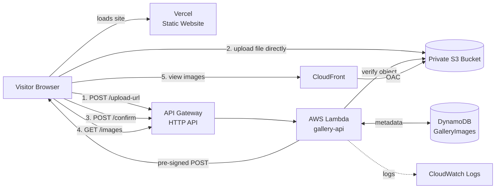

# 🖼 Serverless Image Upload & Gallery Application

A serverless gallery web app. Visitors upload images, the files go **straight to a private Amazon S3 bucket** using a **pre-signed upload**, and the images appear in a live gallery delivered through **Amazon CloudFront**. The website itself is deployed on **Vercel**.

> **Level:** Intermediate  |  **Region used:** Asia Pacific (Mumbai) `ap-south-1`

---

## 📑 Table of Contents

1. [Overview](#-overview)
2. [Problem Statement](#-problem-statement)
3. [Services and Tools Used](#-services-and-tools-used)
4. [Architecture](#-architecture)
5. [How It Works](#-how-it-works)
6. [Prerequisites](#-prerequisites)
7. [Repository Structure](#-repository-structure)
8. [Step-by-Step Guide (AWS)](#-step-by-step-guide-aws)
9. [Testing](#-testing)
10. [Deploy to Vercel](#-deploy-to-vercel)
11. [Cost](#-cost)
12. [Security Best Practices](#-security-best-practices)
13. [Cleanup](#-cleanup)
14. [Troubleshooting](#-troubleshooting)
15. [Future Improvements](#-future-improvements)
16. [What You Will Learn](#-what-you-will-learn)

---

## 📌 Overview

1. The visitor picks an image on the website.
2. The browser asks the API for **permission to upload** (`POST /upload-url`).
3. Lambda checks the file type and size and returns a **pre-signed POST**, a temporary permission to upload exactly one file.
4. The browser uploads the file **directly to S3**. The image never passes through Lambda or API Gateway.
5. The browser tells the API the upload is finished (`POST /confirm`). Lambda checks that the file really exists in S3 and saves it as uploaded in **DynamoDB**.
6. The gallery loads the list (`GET /images`) and shows the pictures through **CloudFront** (fast and HTTPS).
7. The uploader can **delete** their own images later (`POST /delete`). A secret delete token, kept in the uploader's browser, proves who uploaded the image.

---

## ❗ Problem Statement

Letting users upload files is risky and expensive if done the simple way.

| Simple approach | This project |
|---|---|
| Files pass through your server or Lambda (slow, size limits, extra cost) | Files go **directly to S3** |
| Bucket made public so images can be shown | Bucket stays **private**; only CloudFront can read it |
| Anyone can upload any file of any size | S3 itself enforces **type and size limits** |
| Images load from one region | CloudFront caches them at edge locations |

---

## 🧰 Services and Tools Used

| Service | Role |
|---|---|
| **Amazon S3** | Private bucket that stores the uploaded images |
| **Amazon CloudFront** | HTTPS delivery of images, using Origin Access Control (OAC) |
| **Amazon API Gateway (HTTP API)** | Public API with four routes, CORS, and throttling |
| **AWS Lambda** | Creates pre-signed uploads, confirms uploads, lists and deletes images |
| **Amazon DynamoDB** | Stores image metadata (id, title, key, size, status, dates) |
| **AWS IAM** | Least-privilege role for Lambda |
| **Amazon CloudWatch** | Lambda logs |
| **Vercel** | Hosts the website (static HTML, CSS, JS) |
| **GitHub** | Source code, connected to Vercel for automatic deployments |

---

## 🏗 Architecture



**Text version:**

```
Vercel (website)
   │
   ├─ POST /upload-url ─► API Gateway ─► Lambda ─► (pre-signed POST + "pending" item in DynamoDB)
   ├─ upload file ──────► S3 (private bucket)          [directly from the browser]
   ├─ POST /confirm ────► API Gateway ─► Lambda ─► (checks S3, marks item "uploaded")
   ├─ GET /images ──────► API Gateway ─► Lambda ─► DynamoDB
   ├─ POST /delete ─────► API Gateway ─► Lambda ─► (checks the delete token, removes the file from S3 and the record from DynamoDB)
   └─ show images ──────► CloudFront ─► S3 (via Origin Access Control)
```

---

## ⚙ How It Works

**API routes (one Lambda function handles all three):**

| Route | What it does |
|---|---|
| `POST /upload-url` | Validates `contentType` and `size`, creates a unique key like `uploads/<uuid>.png`, saves a **pending** item, and returns a pre-signed POST |
| `POST /confirm` | Checks the object exists in S3, then marks the item **uploaded** |
| `GET /images` | Returns uploaded images, newest first, with CloudFront URLs |
| `POST /delete` | Deletes an image, but only if the request carries the secret delete token of that image |

**Why a pre-signed POST?** S3 checks the upload against rules Lambda signed in advance:
- the file type must match what was requested
- the size must be between 1 byte and 5 MB
- the link expires after 5 minutes
- it only works for one specific key

So the limits hold even if someone calls S3 without using your website.

**Why a confirm step?** Anyone can ask for an upload link and never use it. The confirm step makes sure only images that really exist in S3 appear in the gallery. Unfinished "pending" items are never listed, and they can be removed automatically with DynamoDB TTL.

**How can users delete their own images without a login?**
- When an image is uploaded, Lambda creates a long random **delete token** and returns it **once**, to the uploader's browser. DynamoDB stores only a **hash** of it, never the token itself.
- The browser keeps the token in `localStorage`. The website shows the 🗑 delete button (on the tile and in the viewer) **only for images whose token it holds**.
- `POST /delete` checks the token against the stored hash. Without the right token, nothing is deleted (`403`), even if someone knows the image id and the API URL.
- Limits: the right to delete lives in **one browser**. Clearing the browser data, or using another device, removes the delete buttons. Images uploaded before this feature have no token, so they can only be deleted from the AWS console. For accounts that work on any device, add Cognito login (see Future Improvements).

**Item in DynamoDB:**

```json
{
  "id": "6f1c0a52-8c1e-4b6a-9a52-0d2f4f0c1a77",
  "key": "uploads/6f1c0a52-8c1e-4b6a-9a52-0d2f4f0c1a77.png",
  "title": "Workshop photo",
  "contentType": "image/png",
  "size": 204800,
  "status": "uploaded",
  "createdAt": "2026-11-20T09:30:12+00:00",
  "uploadedAt": "2026-11-20T09:30:15+00:00",
  "deleteTokenHash": "5f4dcc3b5aa765d61d8327deb882cf99..."
}
```

---

## ✅ Prerequisites

- A working AWS account with a payment method added
- Region set to **Asia Pacific (Mumbai) ap-south-1** (IAM and CloudFront are global)
- A **GitHub** account and a **Vercel** account (sign up with GitHub, the free Hobby plan is enough)
- **Python 3** (to run a local test server) and **Node.js** installed on your computer is optional (Vercel runs the build)
- A few test images: one small PNG/JPG, one over 5 MB, and one PDF (for negative tests)

---

## 📁 Repository Structure

```
aws-serverless-image-gallery/
├── README.md
├── .gitignore
├── frontend/
│   ├── index.html            # Page
│   ├── style.css             # Responsive styling (light and dark)
│   ├── script.js             # Upload, gallery, lightbox
│   ├── config.example.js     # Copy to config.js for local testing
│   ├── build.js              # Vercel build: writes config.js from the API_URL variable
│   ├── package.json
│   └── vercel.json           # Build settings and security headers
├── lambda/
│   └── lambda_function.py
├── iam/
│   └── lambda-policy.json    # Replace the placeholders
├── s3/
│   ├── bucket-policy.json    # CloudFront-only read access (replace placeholders)
│   └── cors-config.json      # Lets the browser upload to S3
├── tests/
│   ├── test-upload-url.json
│   ├── test-confirm.json
│   ├── test-list-images.json
│   └── test-delete.json
└── screenshots/
```

---

## 🚀 Step-by-Step Guide (AWS)

Do the steps in order. Keep a notepad open for the values you will need later (account ID, bucket name, CloudFront domain and ID, API URL).

### Step 1: Create the DynamoDB table

1. Open **DynamoDB → Tables → Create table**.
2. **Table name:** `GalleryImages`
3. **Partition key:** `id` (String)
4. **Table settings:** *Customize settings* → **Capacity mode: On-demand**.
5. Click **Create table**, and wait for **Active**.
6. *(Optional, recommended)* Open the table → **Additional settings → Time to Live (TTL) → Turn on**, with the attribute name `expiresAt`. This removes unfinished uploads automatically.

📸 *Add screenshot: `screenshots/01-dynamodb-table.png`*

---

### Step 2: Create the private S3 bucket

1. Open **S3 → Create bucket**.
2. **Bucket name:** globally unique, for example `gallery-images-mithil-2026`. **Region:** Mumbai.
3. Keep **Block all public access = ON** (default). This bucket is **private**.
4. Click **Create bucket**.

**Add the CORS rule** (so the browser may upload to S3):

1. Open the bucket → **Permissions → Cross-origin resource sharing (CORS) → Edit**.
2. Paste [`s3/cors-config.json`](s3/cors-config.json).
3. For now, keep `http://localhost:5500` and **delete the Vercel line** (you will add it after deployment, or put `*` for a quick test). The JSON must stay valid.
4. **Save changes**.

📸 *Add screenshot: `screenshots/02-s3-bucket-cors.png`*

---

### Step 3: Create the CloudFront distribution

1. Open **CloudFront → Create distribution**.
2. If you are asked to choose a **pricing plan**, choose the **Free plan** (CloudFront now offers flat-rate plans next to pay-as-you-go). Check the limits it lists on the page.
3. **Origin type:** Amazon S3, and select your bucket (choose the bucket from the list, **not** the static website endpoint).
4. Choose **Allow private S3 bucket access to CloudFront** (Origin Access Control). The console creates the OAC for you.
5. **Viewer protocol policy:** *Redirect HTTP to HTTPS*. **Allowed methods:** GET, HEAD. **Cache policy:** the recommended *CachingOptimized*.
6. Leave extra protections (like WAF) off to avoid extra cost, then **Create distribution**.
7. Copy these two values into your notepad:
   - **Distribution domain name**, like `d1234abcd.cloudfront.net`
   - **Distribution ID**, like `E1ABCDEF123456`

**Allow CloudFront to read the bucket:**

1. Open [`s3/bucket-policy.json`](s3/bucket-policy.json) and replace `<YOUR_BUCKET_NAME>`, `<YOUR_ACCOUNT_ID>`, and `<YOUR_DISTRIBUTION_ID>`. (You can also use the **Copy policy** button CloudFront shows after creation.)
2. Open **S3 → your bucket → Permissions → Bucket policy → Edit**, paste it, and **Save**.

Wait until the distribution status is **Enabled** and no longer "Deploying" (a few minutes).

📸 *Add screenshot: `screenshots/03-cloudfront.png`*

> **New AWS account?** CloudFront may refuse to create the distribution with the message *"Your account must be verified before you can add new CloudFront resources."* Open a free **Account and billing** case with AWS Support and include that error message. Until it is approved, **skip this step**: leave the Lambda variable `CLOUDFRONT_DOMAIN` empty (Step 5) and the gallery will show the images through short-lived pre-signed links, with the bucket still private. After AWS approves your account, create the distribution, add `CLOUDFRONT_DOMAIN`, and the app switches to CloudFront with no code change.

---

### Step 4: Create the IAM policy and role

**Policy**

1. Open [`iam/lambda-policy.json`](iam/lambda-policy.json) and replace `<YOUR_BUCKET_NAME>` (twice) and `<YOUR_ACCOUNT_ID>`.
2. **IAM → Policies → Create policy → JSON**, paste it.
3. **Policy name:** `GalleryApiPolicy` → **Create policy**.

**Role**

1. **IAM → Roles → Create role → AWS service → Lambda → Next**.
2. Attach `GalleryApiPolicy` and `AWSLambdaBasicExecutionRole`.
3. **Role name:** `GalleryApiLambdaRole` → **Create role**.

> Lambda needs `s3:PutObject` even though the browser uploads the file. A pre-signed upload only works if the account that signed it is allowed to do the same action. The delete button also needs `s3:DeleteObject` and `dynamodb:DeleteItem`, which are already in the policy file.

📸 *Add screenshot: `screenshots/04-iam-role.png`*

---

### Step 5: Create the Lambda function

1. **Lambda → Create function → Author from scratch**.
2. **Function name:** `gallery-api`. **Runtime:** Python 3.12 (or the latest Python).
3. **Execution role:** *Use an existing role* → `GalleryApiLambdaRole`.
4. **Create function**.
5. On the **Code** tab, replace the code with [`lambda/lambda_function.py`](lambda/lambda_function.py) and click **Deploy**.
6. **Configuration → General configuration → Edit:** set **Timeout = 15 seconds**.
7. **Configuration → Environment variables → Edit** and add:

   | Key | Value |
   |---|---|
   | `BUCKET_NAME` | your bucket name |
   | `TABLE_NAME` | `GalleryImages` |
   | `CLOUDFRONT_DOMAIN` | `d1234abcd.cloudfront.net` (no `https://`). **Leave it out if CloudFront is not available yet.** |
   | `MAX_FILE_SIZE_MB` | `5` (optional) |

8. **Save**.

📸 *Add screenshot: `screenshots/05-lambda.png`*

---

### Step 6: Create the API Gateway (HTTP API)

1. **API Gateway → Create API → HTTP API → Build**.
2. **Add integration → Lambda →** select `gallery-api`. **API name:** `gallery-api`. **Next**.
3. **Routes:** remove the default route and add these four, all pointing to the `gallery-api` Lambda:

   | Method | Resource path |
   |---|---|
   | `POST` | `/upload-url` |
   | `POST` | `/confirm` |
   | `GET` | `/images` |
   | `POST` | `/delete` |

4. **Next** → keep the `$default` stage with **Auto-deploy** → **Next** → **Create**.
5. Copy the **Invoke URL** into your notepad, for example `https://abc123xyz.execute-api.ap-south-1.amazonaws.com`. It has **no path** at the end.

**CORS** (API → **CORS → Configure**):

| Field | Value |
|---|---|
| Access-Control-Allow-Origin | `http://localhost:5500` (add your Vercel URL later) |
| Access-Control-Allow-Methods | `GET`, `POST`, `OPTIONS` |
| Access-Control-Allow-Headers | `content-type` |
| Access-Control-Max-Age | `300` |

**Throttling (recommended):** **Stages → `$default` → Edit → Default route throttling**, and set **Rate 5, Burst 10**.

📸 *Add screenshots: `screenshots/06-api-routes.png`, `screenshots/07-api-cors.png`*

---

## 🧪 Testing

Test from the inside out. Do not move on until each test passes.

### Test 1: Lambda alone

1. **Lambda → gallery-api → Test → Create new event.**
2. **`upload-url-test`:** paste [`tests/test-upload-url.json`](tests/test-upload-url.json) → **Test**.
   **Expected:** `statusCode 200` and a body with `id`, `upload.url`, and `upload.fields`. In DynamoDB, a new item with `status = pending` appears.
3. **`confirm-test`:** paste [`tests/test-confirm.json`](tests/test-confirm.json) and replace the id with the `id` from the previous result → **Test**.
   **Expected:** `statusCode 400`, message *Upload not found*. This is correct, because no file was uploaded, and it proves Lambda verifies S3.
4. **`list-test`:** paste [`tests/test-list-images.json`](tests/test-list-images.json) → **Test**.
   **Expected:** `statusCode 200` and `{"images": []}`.

### Test 2: API Gateway (PowerShell)

Replace the URL with yours.

```powershell
# Should return 200 with an id and upload fields
Invoke-RestMethod -Method Post -Uri "https://YOUR-API-ID.execute-api.ap-south-1.amazonaws.com/upload-url" -ContentType "application/json" -Body '{"contentType":"image/png","size":1000,"title":"API test"}'

# Should return {images: []} (or your images later)
Invoke-RestMethod -Method Get -Uri "https://YOUR-API-ID.execute-api.ap-south-1.amazonaws.com/images"
```

On Mac or Linux, use `curl -X POST ... -H "Content-Type: application/json" -d '...'`.

### Test 3: Run the website locally

1. Open a terminal in the `frontend` folder.
2. Create your local config:
   - Windows: `copy config.example.js config.js`
   - Mac/Linux: `cp config.example.js config.js`
3. Open `config.js` and set `API_URL` to your Invoke URL (no trailing slash).
4. Start a local server on **port 5500** (this must match the CORS rule):
   ```
   python -m http.server 5500
   ```
   (On Windows you can use `py -m http.server 5500`.)
5. Open **http://localhost:5500** in your browser. Use `localhost`, not `127.0.0.1`.

### Test 4: Upload an image (the full flow)

1. Choose a small PNG or JPG, add a title, and click **Upload**.
2. **Expected:**
   - A progress bar runs, then **Upload complete!**
   - The image appears at the top of the gallery.
   - Click the image to open the viewer. Press **Esc** or the × to close.
3. **Refresh** the page. The image should still be there.
4. Verify in AWS:
   - **S3:** the file is in `uploads/`
   - **DynamoDB:** the item shows `status = uploaded`
   - **CloudFront:** open the image URL (right-click the image → *Open image in new tab*). It must start with `https://d....cloudfront.net/`

### Test 5: The bucket really is private

1. In S3, open the uploaded object and copy its **Object URL**.
2. Open it in the browser. **Expected:** `AccessDenied`. Direct access is blocked.
3. The CloudFront URL for the same image **does** work. (Without CloudFront, the gallery link is a pre-signed one that contains `X-Amz-Signature` and expires after an hour.)

### Test 6: Negative tests

| Test | How | Expected |
|---|---|---|
| Wrong file type | Choose a PDF on the website | Error: only JPG, PNG, WEBP, GIF |
| File too large | Choose an image over 5 MB | Error: image must be smaller than 5 MB |
| Bypass the website: bad type | `Invoke-RestMethod -Method Post -Uri "<API>/upload-url" -ContentType "application/json" -Body '{"contentType":"application/pdf","size":1000}'` | `400` error |
| Bypass the website: huge size | Same call with `"contentType":"image/png","size":10000000` | `400` error |
| Fake confirm | `<API>/confirm` with `{"id":"not-an-id"}` | `400` Invalid image id |

PowerShell shows a `400 Bad Request` error for the failing calls. That is the correct result.

### Test 7: Check the logs

**CloudWatch → Log groups → `/aws/lambda/gallery-api`** → latest stream. Look for `Route: POST /upload-url`, `Confirmed image ...`, and `Returning N images`.

### Test 8: Delete an image

1. Open the website (the same browser you used to upload) and upload a test image with the title `delete me`.
2. **Expected:** the new tile has a round 🗑 button in its top-right corner. Images you did not upload from this browser have **no** button.
3. Click the 🗑 button. **Expected:** a popup asks *Delete this image?*
4. Click **Cancel**. **Expected:** nothing changes.
5. Click 🗑 again and then **Delete**. **Expected:** the tile disappears and a green *Image deleted.* message shows.
6. Check AWS:
   - **S3 → `uploads/`:** the file is gone (refresh the list)
   - **DynamoDB → `GalleryImages`:** the item is gone
7. **Viewer:** open one of your own images, then check the **Delete this image** button inside the viewer. It must not appear for images you did not upload.
8. **Security check (PowerShell):** use the id of any image **and a wrong token**:
   ```powershell
   Invoke-RestMethod -Method Post -Uri "<API-URL>/delete" -ContentType "application/json" -Body '{"id":"<AN-IMAGE-ID>","deleteToken":"wrong-token"}'
   ```
   **Expected:** `403 Forbidden` and the image is still in the gallery. A missing token or a fake id gives `400`.
9. **Other browser check:** open the site in another browser or a private window. **Expected:** the gallery shows the same images, but **no** delete buttons.

### Checklist

| Test | Pass condition |
|---|---|
| 1. Lambda events | `200`, `400 Upload not found`, `200 empty list` |
| 2. API calls | Same results through the API URL |
| 3. Local website | Page loads with "No images yet" |
| 4. Upload | Progress bar, image in gallery, saved in S3 and DynamoDB |
| 5. Private bucket | S3 URL denied, CloudFront URL works |
| 6. Negative tests | Rejected with clear errors |
| 7. Logs | Route and confirm lines visible |
| 8. Delete | Own image deleted from S3 and DynamoDB; wrong token gives 403; no buttons in another browser |

📸 *Add screenshots: `screenshots/08-local-website.png`, `screenshots/09-s3-object.png`, `screenshots/10-dynamodb-item.png`, `screenshots/11-s3-access-denied.png`, `screenshots/12-cloudwatch-logs.png`*

---

## ▲ Deploy to Vercel

Deploy only **after** all tests pass.

### Before you push to GitHub

- `frontend/config.js` is in `.gitignore`, so your real API URL is **not** committed.
- Make sure the policy files still contain placeholders (`<YOUR_ACCOUNT_ID>`, `<YOUR_BUCKET_NAME>`, and so on).
- Blur your account ID and emails in screenshots.

### Deploy

1. Push the repository to GitHub.
2. Sign in at **vercel.com** with your GitHub account.
3. Click **Add New → Project** and **Import** your `aws-serverless-image-gallery` repository.
4. Configure the project:

   | Setting | Value |
   |---|---|
   | **Framework Preset** | Other |
   | **Root Directory** | `frontend` (click *Edit* and select the folder) |
   | **Build Command** | `npm run build` |
   | **Output Directory** | `dist` |
   | **Environment Variable** | Name: `API_URL`, Value: your API Invoke URL (starts with `https://`, no trailing slash, no path) |

5. Click **Deploy**. When it finishes, copy your site URL, for example `https://aws-gallery-yourname.vercel.app`.

How it works: `build.js` copies the site into `dist/` and writes `dist/config.js` from the `API_URL` variable, so the repo stays clean.

### Allow your Vercel site to call AWS (two CORS settings)

The browser blocks requests until both AWS services trust your Vercel URL. Use the **exact** URL, with `https://` and **no trailing slash**.

1. **API Gateway → CORS → Edit:** add `https://aws-gallery-yourname.vercel.app` to the allowed origins (keep `http://localhost:5500` if you still test locally).
2. **S3 bucket → Permissions → CORS → Edit:** add the same URL to `AllowedOrigins` in the JSON.

### Test the live site

1. Open your Vercel URL.
2. Repeat **Test 4** (upload, gallery, viewer, refresh) and **Test 6** (wrong type, too large).
3. Press **F12 → Console** if anything fails. A message containing "CORS" means one of the two settings above is wrong.

📸 *Add screenshots: `screenshots/13-vercel-deployment.png`, `screenshots/14-live-site.png`*

### Updating later

- Pushing to GitHub redeploys automatically.
- If you change the `API_URL` variable in Vercel, click **Redeploy**, because the value is read at build time.

---

## 💰 Cost

- **Lambda, API Gateway, DynamoDB (on-demand), CloudWatch:** very small for a workshop.
- **S3:** pennies for a few images.
- **CloudFront:** has a free option and a monthly free allowance. Pricing plans have changed recently, so check the plan the console shows you.
- **Vercel Hobby:** free for personal and learning projects.

> Check current pricing and Free Tier terms at [aws.amazon.com/free](https://aws.amazon.com/free). Set a **Zero spend budget** in AWS Budgets as a safety net.

---

## 🔐 Security Best Practices

- ✅ **Private bucket** with Block Public Access on. Only CloudFront can read, through Origin Access Control and a policy locked to your distribution.
- ✅ **Pre-signed POST** limits uploads to one key, 5 minutes, allowed type, and size range, enforced by S3 itself.
- ✅ **Random UUID file names**, so users cannot overwrite or guess other files.
- ✅ **Server-side validation** of type and size (the browser checks too, but is never trusted).
- ✅ **Confirm step** verifies the file exists before it is listed.
- ✅ **Delete tokens:** only the uploader's browser can delete an image. Only a hash of the token is stored, and it is compared in constant time.
- ✅ **Least-privilege IAM**, limited to one bucket prefix and one table.
- ✅ **CORS restricted** to your own site addresses.
- ✅ **Throttling** on the API to limit abuse.
- ⚠️ This gallery has **no login**, so anyone with the site can upload. Share the link carefully, and delete the project after the workshop (see Future Improvements for authentication).
- ⚠️ Delete tokens live in the browser's `localStorage`. Anyone with access to your browser profile can delete your images, and clearing browser data removes your delete rights.
- ❌ Never commit AWS keys, `config.js`, or screenshots showing your account ID.

---

## 🧹 Cleanup

1. **Vercel:** delete the project (Settings → Delete project).
2. **CloudFront:** open the distribution, click **Disable**, wait until it is deployed, then **Delete**.
3. **S3:** open the bucket → **Empty** → **Delete** the bucket.
4. **API Gateway:** delete `gallery-api`.
5. **Lambda:** delete `gallery-api`.
6. **CloudWatch:** delete the log group `/aws/lambda/gallery-api`.
7. **DynamoDB:** delete the `GalleryImages` table.
8. **IAM:** delete `GalleryApiLambdaRole` and `GalleryApiPolicy`.

---

## 🛠 Troubleshooting

| Problem | Likely cause | Fix |
|---|---|---|
| Console shows **CORS error** on `/images` or `/upload-url` | Your site origin is missing in the **API Gateway** CORS | Add the exact origin (no trailing `/`), methods `GET, POST, OPTIONS`, header `content-type` |
| Upload fails with a network or CORS error at the S3 step | Your site origin is missing in the **S3 bucket** CORS | Add it to `AllowedOrigins` in the bucket CORS JSON |
| S3 returns `AccessDenied` or `SignatureDoesNotMatch` on upload | Lambda role lacks `s3:PutObject`, wrong bucket name, or the link expired | Check `GalleryApiPolicy` and the `BUCKET_NAME` variable; upload again within 5 minutes |
| S3 returns `Policy Condition failed` | The file type or size differs from the request | Use JPG, PNG, WEBP or GIF under 5 MB |
| S3 returns `TemporaryRedirect` / 307 | Brand-new bucket not yet available at the regional address | Wait 10 to 30 minutes and retry |
| Image shows as broken in the gallery | `CLOUDFRONT_DOMAIN` is wrong, or the bucket policy does not match your distribution | Use `dxxxx.cloudfront.net` without `https://`; check the distribution ID in the bucket policy |
| CloudFront shows `AccessDenied` for a real image | Bucket policy missing or wrong ARN | Re-paste the policy with the right account ID, bucket, and distribution ID |
| CloudFront still "Deploying" | New distributions need a few minutes | Wait until the status is Enabled |
| `/confirm` says *Upload not found* after a real upload | The upload failed, or Lambda lacks `s3:GetObject` / `s3:ListBucket` | Check the policy and the S3 `uploads/` folder |
| `500 Server configuration error` | Missing Lambda environment variables | Add `BUCKET_NAME` and `TABLE_NAME` |
| CloudFront: *"Your account must be verified..."* | New accounts need CloudFront verification | Contact AWS Support (Account and billing) with the error message; meanwhile leave `CLOUDFRONT_DOMAIN` empty |
| Images stop loading after about an hour (without CloudFront) | Pre-signed image links expire | Press **Refresh** on the page to get new links, or set up CloudFront |
| `AccessDenied` for DynamoDB in logs | Wrong account ID or table name in the policy | Fix the table ARN |
| Page loads but the gallery is empty | Nothing uploaded yet, or uploads were never confirmed (only confirmed images are listed) | Upload an image and wait for **Upload complete!**. Test the API directly: open `<API-URL>/images` in a browser tab. You should see `{"images": [...]}` |
| Gallery shows an error with **Technical details** | The page reports the exact cause (no response = CORS or wrong URL, 404 = missing route, 500 = Lambda error) | Open **Technical details**, follow the hint above it, and send the text when asking for help |
| No 🗑 button on my image | The image was uploaded before the delete feature, from another browser, or browser data was cleared | Upload a new image from this browser. Old images can be deleted in the AWS console. |
| Delete returns `403` *"only delete images you uploaded from this browser"* | The token in this browser does not match the image | Expected for other people's images. The button is removed automatically. |
| Delete returns `500` or *Server error* | Lambda role lacks `s3:DeleteObject` or `dynamodb:DeleteItem` | Update `GalleryApiPolicy` with the new permissions and check the CloudWatch logs |
| Delete returns *API route not found* / API Gateway `Not Found` | The `POST /delete` route was not added | Add route `POST /delete` and attach the `gallery-api` Lambda integration |
| Delete route returns `Internal Server Error` and Lambda logs show nothing | API Gateway is not allowed to invoke Lambda for the new route | In the route, attach the Lambda integration again so the permission is created |
| Page says "API URL is not configured" | `config.js` missing locally, or `API_URL` not set on Vercel | Create `config.js` from `config.example.js`, or add `API_URL` in Vercel and redeploy |
| Vercel build fails: "API_URL environment variable is not set" | Variable missing | Add it under Project Settings → Environment Variables, then Redeploy |
| Vercel shows 404 | Wrong Root or Output Directory | Root Directory `frontend`, Output Directory `dist` |
| Local page cannot reach the API | Using `127.0.0.1` or another port | Use `http://localhost:5500` exactly |
| Old behaviour after editing Lambda code | Not deployed | Click **Deploy** after editing |

---

## 🔮 Future Improvements

- 🔑 **Login with Amazon Cognito**, so only signed-in users can upload or delete their own images
- 👮 An **admin** page to remove images from any user
- 🖼 **Thumbnails** generated by an S3-triggered Lambda
- 🛡 **Moderation** with Amazon Rekognition to block unsafe images
- 📄 **Pagination** and a DynamoDB index instead of a table scan
- 🌐 Custom domain with **Route 53** and **ACM**
- 🧱 Rebuild everything as **Infrastructure as Code** (AWS SAM, CloudFormation, or Terraform)

---

## 🎓 What You Will Learn

- **Pre-signed URLs**, a core real-world AWS pattern
- Giving users limited rights with a secret **delete token**, instead of a full login
- Keeping an S3 bucket **private** and serving files safely with **OAC**
- Designing a small **serverless REST API**
- Two kinds of **CORS** (API Gateway and S3)
- **IAM least privilege** for S3 and DynamoDB
- Deploying a frontend on **Vercel** from GitHub, with **environment variables**
- Testing, logging, and troubleshooting a multi-service application

---

## 👥 Contributors

Built by the **AWS Student Builders Group**, **LJIET**.

| Name | Role |
|---|---|
| Mithil Dave | Project author |

---

## 📄 License

This project is for educational purposes. Feel free to fork, learn, and improve it.
